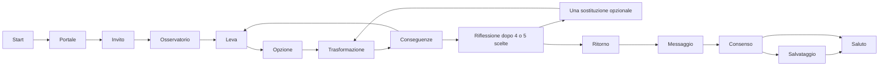

# Future Observatory V4 · architettura

La specifica autorevole è `SPEC.md`. Una sola città ambientale nasce critica e riceve interventi cumulativi: non si caricano città alternative e non esiste un obiettivo di vittoria.

Il catalogo definisce identità e testi, DecisionEngine ricostruisce la città dalle scelte attive, StoryEngine valida stato e consenso, CityTransformationEngine anima geometrie predefinite. Conversation Engine conserva WebRTC durante ingresso, modifiche e ritorno. Il modello riceve lo stato autorevole e risultati dei tool; non può eseguire Three.js.

La revisione mantiene slot e sequenza originale, aggiorna un solo intervento e ricostruisce tutte le conseguenze. La narrazione usa un clock separato dal rendering, così l’ingresso non si blocca se il canvas mobile è fuori viewport. La trasformazione dura sette secondi su tempo monotono; pausa e ripresa conservano l’avanzamento. Il portale dura cinque secondi, è ancorato nello spazio e viene chiuso dopo l’arrivo. Il nome resta in memoria locale per la sola visita.

La stanza misura circa 5×5 m e ha una vera apertura, soffitto, pavimento PBR e tavolino. Vicino: edifici e mobilità 3D. Intermedio: volumi semplificati. Lontano: skyline instanziato e shader del cielo. I piccoli spostamenti reali generano parallasse; il seguace laterale evita gli ostacoli virtuali conosciuti, senza garantire rilevamento di ostacoli reali.

Per ogni scelta NEO orienta lo sguardo verso il settore pertinente e un segnale locale indica brevemente la modifica. Sky/smog, materiali, connessioni e strati vengono interpolati; il resto della città continua ad animarsi. I suoni sintetici sono quieti, cambiano con gli interventi e sono attenuati durante voce/input. L’illuminazione è statica, senza post-processing.

Developer separato, risorse qualitative interne e diagnosi sono visibili soltanto dopo apertura esplicita. Reset e ingresso manuale permettono prove senza chiave OpenAI. I test hardware non sono sostituiti da quelli browser.
