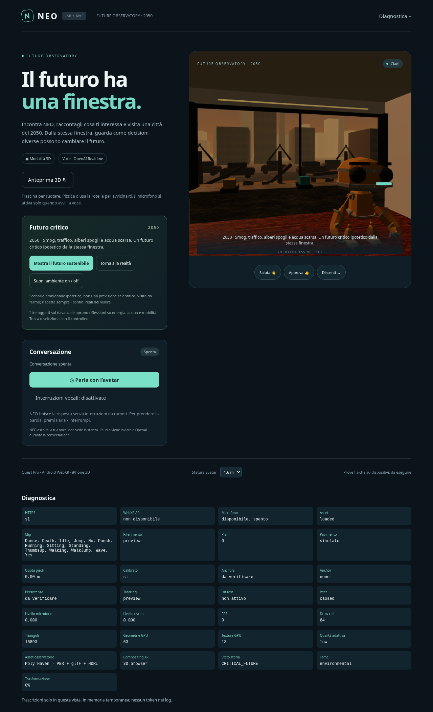
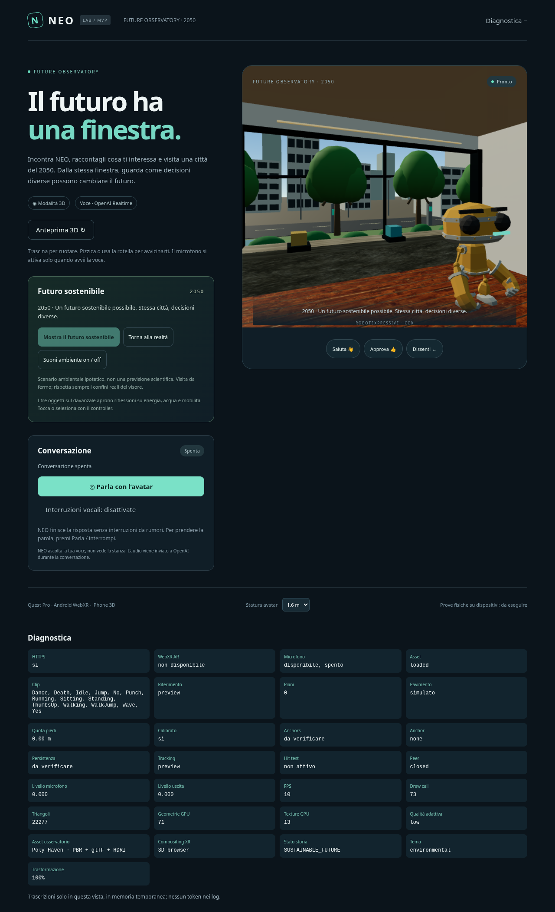

# Future Observatory — estensione MVP

L’avatar, il backend Node, WebRTC OpenAI Realtime e il posizionamento MR dell’MVP sono riutilizzati. Sono disponibili **sei futuri predefiniti**: ambiente, economia e società, ciascuno critico e sostenibile.

## Prova rapida

Aprire la pagina HTTPS direttamente, avviare **Parla con l’avatar**, raccontare un interesse e accettare l’invito al 2050. Il modello usa funzioni strutturate e riceve lo stato autorevole dopo ogni evento. Il selettore e il dock/menu Quest cambiano tema prima o durante la visita, senza tornare alla MR; preservano il futuro corrente, il robot e la voce. In alternativa **Visita il 2050** permette di provare la grafica senza API né microfono. **Mostra il futuro sostenibile / critico** autorizza una trasformazione di otto secondi in entrambe le direzioni; **Torna alla realtà** interrompe anche ingresso e trasformazione. I tre oggetti sul davanzale aprono riflessioni specifiche del tema corrente. **Suoni ambiente** è facoltativo e richiede un gesto.

Sul Quest iniziare con **Entra in realtà mista**, attendere il posizionamento automatico del robot a 1,3 m (calibrare se richiesto) e poi visitare. La stanza viene allineata una volta alla posa della testa e alla quota del pavimento, poi resta nel mondo: nessuna locomozione artificiale della camera. Il robot può avvicinarsi lentamente al fianco dell’utente nella stanza virtuale, rispettando pareti e arredi predefiniti. La posizione MR dell’avatar è conservata e ripristinata al ritorno. Nessun movimento fisico è necessario; il confine virtuale non sostituisce il Guardian reale.

## Moduli

- `src/story/StoryEngine.ts`: macchina a stati pura, registry dei temi, consenso, validazione esatta degli argomenti, rifiuto di eventi fuori sequenza, ritorno interrompibile.
- `server/story-config.ts`: prompt italiano e otto strumenti Realtime, inclusi memoria e cancellazione del nome nella pagina. Nessuna geometria è creata dal modello. Tutti i temi richiedono consenso prima dell’ingresso.
- `src/audio/realtimeClient.ts`: usa solo `response.function_call_arguments.done`, deduplica i call ID, invia `function_call_output` e attende `response.done` per la risposta successiva. Deltas e trascrizioni non attivano eventi. Lo stato è risincronizzato quando il data channel apre. Domande vocali e barge-in continuano nel medesimo peer.
- `src/observatory/FutureObservatory.ts`: stanza 5 × 5 × 3 m, apertura panoramica geometrica, PBR, arredo glTF, luce naturale, skyline e oggetti narrativi. Nessun video o generazione AI di ambienti.
- `src/Experience.ts`: applica gli eventi autorizzati, allinea la stanza, interpola con tempo monotono assoluto ingresso 3 s / trasformazione 8 s / ritorno 2,5 s (non perde durata quando i frame rallentano), ripristina avatar e camera. Gli anchor MR non aggiornano l’avatar mentre è figlio dell’osservatorio.
- `src/observatory/performance.ts`: tre livelli di qualità dopo tre campioni lenti, risoluzione browser e foveation XR adattive, framebuffer ridotto dalla sessione successiva.
- `src/observatory/UrbanLife.ts`: persone, consegne/navetta, componenti di riuso e segnali di degrado animati, attivi fin dall’ingresso nei due quartieri civici. Aggiornamento a 30 Hz solo del distretto visibile, istanze e bounds conservativi.
- `src/observatory/Ambience.ts`: rumore filtrato e ronzio sintetici a volume basso, crossfade e attenuazione durante la voce; nessun file audio remoto.

## Stati ed eventi

| Stato | Uscita autorizzata |
|---|---|
| INTRODUCTION | Avvio voce → DISCOVER_INTEREST |
| DISCOVER_INTEREST | `select_theme` per uno dei tre temi → INVITATION |
| INVITATION | `enter_observatory(consent: true)` → ENTER_OBSERVATORY |
| ENTER_OBSERVATORY | Completamento interno del renderer → CRITICAL_FUTURE |
| CRITICAL_FUTURE | `reflect` → REFLECTION; consenso alternativo → trasformazione |
| REFLECTION | `transform_future(future: critical/sustainable, consent: true)`; renderer completa → futuro richiesto |
| SUSTAINABLE_FUTURE | Dialogo libero, confronto con il critico; ritorno sempre disponibile |
| RETURN_TO_REALITY | Completamento interno → CONCLUSION |
| CONCLUSION | Nuova scoperta o nuova visita |

`select_theme` è valido anche durante ingresso, riflessione e trasformazione; il cambio non riavvia il timer e non riallinea stanza/avatar. Durante il ritorno il tema resta bloccato per 2,5 secondi. `return_to_reality` è valido da ogni stato nell’osservatorio, anche durante una transizione. Il modello non può chiamare i completamenti interni. Tool sconosciuti, proprietà aggiuntive, JSON malformato, tipi errati e argomenti oltre 2 KiB sono rifiutati. La certezza che il consenso vocale sia stato espresso dipende dal modello; i pulsanti sono un’alternativa esplicita e prevedibile.

## Città e materiali

18 edifici vicini a 12–24 m, 32 intermedi a 38–58 m e 38 lontani a 72–92 m costituiscono tre fasce. Gli edifici, strade, finestre, alberi e pannelli sono geometrie 3D instanziate, quindi il movimento della testa produce vera parallasse. La distanza e la foschia limitano il dettaglio dello skyline. La stanza contiene un’apertura reale, non una fotografia su un piano.

La stessa geometria cambia gradualmente colore e resa: luce calda e foschia densa diventano luce più chiara e cielo blu, foglie secche crescono, pannelli e tram appaiono. Si riutilizzano i materiali senza ricreare la città. Il realismo è un primo compromesso: edifici procedurali semplici, nessuna metropoli percorribile, acqua/scarsità sono soprattutto temi narrativi. Tavolino realistico, pavimento e davanzale usano gli asset Poly Haven documentati in `ASSET_CREDITS.md`.

Gli asset vengono precaricati dopo l’avvio, una famiglia per volta, senza attendere per avviare WebRTC. Sono serviti dallo stesso origin. Errori di download conservano materiali/arredi procedurali; la diagnostica segnala quanti gruppi sono disponibili. JPG 1k compressi e HDRI 1k riducono download e memoria. Non sono implementati KTX2, Draco o Meshopt: i 4.504 triangoli del tavolino non giustificano un decoder aggiuntivo in questa versione.

## AR / VR e limiti verificabili

`isSessionSupported` controlla separatamente `immersive-ar` e `immersive-vr`. Una sessione AR con compositing alpha-blend può essere coperta dalla stanza opaca e dal cielo completo: questo è **implementato, non verificato sul Quest Pro**. Un compositor additive è rifiutato perché non può occultare la realtà.

Quando serve una sessione separata, **Prepara VR** (anche nel pannello 3D del visore) verifica il supporto VR e chiude AR; **Entra in VR**, con un nuovo gesto dell’utente, richiede esplicitamente `immersive-vr`. La conversazione non viene chiusa dal lifecycle XR. Un ritorno da VR chiude la sessione e mostra il pulsante MR: il browser può richiedere un altro gesto, non esiste uno switch AR/VR automatico. La posa viene riallineata nel nuovo riferimento, senza promettere corrispondenza degli spazi fra sessioni. VR non ripristina/cancella gli anchor persistenti MR. Il cambio di visibilità della pagina può comunque interrompere la voce per la politica privacy preesistente; l’app non può garantire continuità se il browser mette la pagina in background durante uno switch.

Il rendering MR coprente, la continuità audio durante session switching, il comportamento dei Guardian e il refresh devono essere provati sul dispositivo fisico. Diagnostica mostra session mode/environmentBlendMode e indica esplicitamente che l’occultamento è da verificare.

## Performance e mobile

Niente post-processing o shadow map. Frustum culling standard Three.js, istanze condivise e riduzione del dettaglio/skyline; gli oggetti statici non vengono ricostruiti. Si richiedono 72 Hz solo se dichiarati nelle supportedFrameRates. Dopo tre campioni sotto l’85% del target si riduce il livello; target browser 50 FPS, XR 72 FPS. La qualità non oscilla automaticamente verso l’alto. La foveation cambia in sessione; WebXR impone di applicare il framebuffer scale prima della sessione successiva.

La diagnostica espone FPS campionati ogni secondo, draw call, triangoli, conteggi geometrie/texture GPU, qualità e stato asset. WebGL non fornisce memoria GPU in byte affidabile: i conteggi non sono presentati come una misura in MiB. I dati software raccolti in `VALIDATION.md` non dimostrano 72 FPS sul Quest.

Android conserva AR dove supportata, altrimenti usa il browser 3D. iPhone usa WebKit con rotazione e zoom touch limitati all’interno della stanza; nessuna falsa simulazione del passthrough. La voce resta indipendente dalla modalità grafica. Le prove browser emulano viewport/input, non sostituiscono i telefoni fisici.

## Estensioni successive

Per aggiungere altri temi seguire il registry `src/story/scenarios.ts` e scene predefinite con messaggi coerenti. Conservare il protocollo autorizzato; non dare accesso Three.js al modello. Prima di aumentare il realismo, misurare sul Quest Pro i tempi CPU/GPU e ridurre il carico per mantenere comfort. La città è uno scenario ipotetico del 2050, non una previsione scientifica.

## Anteprime browser

Screenshot della stessa stanza, prima e dopo la trasformazione, in Chromium desktop con rendering software e qualità adattiva low. La prospettiva è stata ruotata con il mouse. Non sono prove su Quest.

| Critico | Sostenibile |
|---|---|
|  |  |

La revisione successiva alla prova Quest aggiunge menu richiudibile, selezione controller/mani, interruzioni filtrate e un confronto ambientale più marcato. Vedere [QUEST_INTERACTION.md](QUEST_INTERACTION.md).
