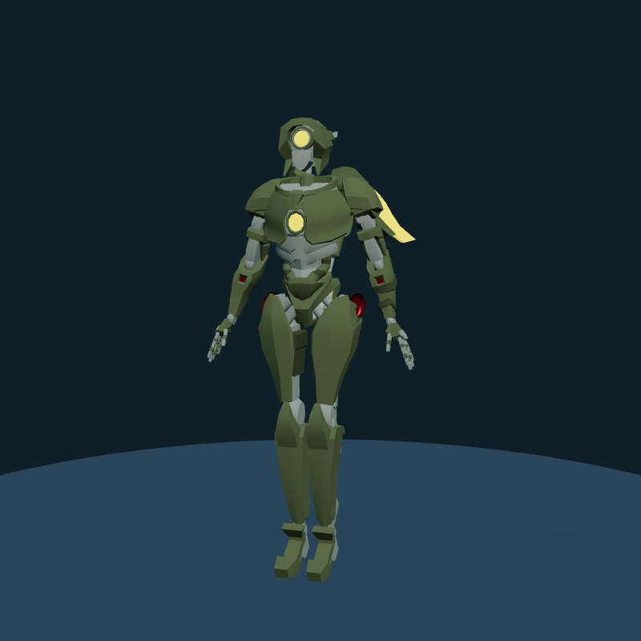

# Alternativa umanoide futuristica

Candidato selezionato: **“Rigged robot” di joney_lol**, [Poly Pizza](https://poly.pizza/m/BwjA6Thdzd), [CC BY 3.0](https://creativecommons.org/licenses/by/3.0/). Licenza verificata sulla scheda del modello, con testo legale, attribuzione e prova della fonte in `public/models/humanoid/`. Il modello ha proporzioni umane, corazza meccanica e dettagli emissivi; resta una resa stilizzata, non fotorealistica.

[GLB locale](../public/models/humanoid/RiggedRobot.glb) · [Attribuzione e modifiche](../public/models/humanoid/LICENSE.md) · [Manifest/checksum](../public/models/humanoid/manifest.json). L’immagine è un render locale del modello adattato; autore e licenza come sopra.

| Proprietà misurata | Valore |
|---|---|
| GLB | 1.551.944 byte |
| Triangoli effettivi | 18.299 (la scheda riporta 14.941) |
| Primitive / materiali | 6 / 6 |
| Rig | 48 ossa, `head` minuscolo |
| Texture / decoder / file esterni | Nessuno |
| Animazioni incluse | Nessuna |
| Orientamento | Y verticale, fronte +Z |
| Altezza sorgente | 12,515 m; normalizzata a 1,6 m nell’anteprima |

L’originale contiene otto vettori di skin weight non finiti. La copia locale li corregge a `[1,0,0,0]`: gli indici originali sono tutti zero e la verifica del vertice valido più vicino conferma gli stessi pesi/indici. La geometria, i materiali e gli altri dati restano invariati. Modifica dichiarata nel credito e nel manifest; il test verifica checksum, pesi finiti, rig, budget e quota/altezze dopo normalizzazione. Il render browser carica effettivamente GLTFLoader: sette draw call / 18.347 triangoli includendo il piano.

**NEO resta RobotExpressive.** Il candidato non viene scaricato, precaricato o renderizzato nella visita e non influisce sui costi della città. Non è una sostituzione animata completa: servono un profilo avatar per `head` e gesti di saluto/ascolto/parlato/camminata compatibili, poi verifica Quest. Non fingiamo che le clip `Idle`, `Wave`, `Yes`, `No`, `ThumbsUp` esistano nel file.

Seconda opzione valutata: [Animated Robot di Quaternius](https://poly.pizza/m/QCm7qe9uNJ), scheda asset CC0, 401 KB / 3.237 triangoli / 14 clip. Più leggero ma con testa molto grande e stile giocattolo: meno adatto alla richiesta umanoide. Non è integrato. La pagina generale Quaternius è passata a QAL in agosto 2026: per futuri download si deve verificare la licenza del singolo asset, senza attribuire CC0 automaticamente all’intero catalogo.
